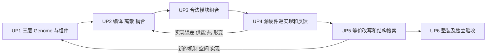

# v4 多拓扑生成：核心规划与执行入口

版本：`v4-upgrade-plan-20260914.1`。本目录保存当前架构、执行路线、工作单和未完成事项；`docs/implementation/` 保存实现记录与历史快照。本文是规划，不能作为代码实现或物理验收证据。

## 1. 本次调整与目标

按 2026-09-14 用户指令，先扩大三层 Genome 的可执行表达能力，再完成物理编译、空间离散与耦合，验证合法模块组合，完成逆向 realization 与工程反馈，最后接入条件 e-graph 和更广的演化搜索。三层 Genome 允许版本化补齐；旧版合同、候选身份和历史 evidence 不得被原地重解释。本次指令替代旧版“本目录不修改 Genome”及搜索优先的实施顺序。

保留完整父目标：用同一条可复现链路完成真实参考对象表示、可识别的隐参数逆恢复与留出预测，再通过 G1/G2/G3 的机制、场、几何、拓扑、实现和控制搜索，产生至少一个经过独立物理、工程、整装净输出及原创性审查的 L4 候选。R01–R10 不能被局部里程碑代替。建成装置并测得正净输出是额外的 L5 证据要求。

这里的“通用”是**在声明的模型、空间和数值适用域内，依据合同自动组合并可扩展**。有限软件不承诺任意抽象拓扑都可物化、任意等离子体模型都可闭合、任意目标场都有可制造源。

## 2. 阅读路径

所有执行者先读 [00 共同合同](00_normative_contracts_and_state_model.md)，再读本页和 [16 工作单](16_execution_work_orders.md)。任务状态与依赖以 [task_manifest.json](task_manifest.json) 为准；文本工作单拥有技术步骤，机器清单拥有调度关系，二者冲突必须先修正。

| 阅读者或任务 | 必读文件 |
|---|---|
| Sol（high）总调度 | [主线提示词，500 字以内](15_sol_system_prompt.md)、[14 协作与决策](14_agent_orchestration.md)、16、13 |
| Luna（high）执行者 | [17 执行提示词](17_luna_worker_prompt.md)、被分配工作单、00、对应技术章 |
| Genome 补齐 | [G1](<G1 机制基因组.md>)、[G2](<G2 场—几何基因组.md>)、[G3](<G3 实现—控制Genome.md>)、[10 升级实施](10_genome_upgrade_execution.md) |
| 编译、离散与耦合 | [01 抽象编译](01_candidate_integration_and_abstract_compilation.md)、[11 执行编译](11_physics_compilation_and_discretization.md) |
| 模块组合、源与硬件逆实现 | [05 realization 合同](05_realization_and_independent_physics_execution.md)、[12 组合与逆实现](12_composition_and_inverse_realization.md) |
| 验证和最终证据 | [13 验收协议](13_acceptance_benchmarks_and_evidence.md)、[06 物理 frontier](06_multifidelity_hard_physics_frontier.md)、[08 整装 VVUQ](08_high_fidelity_whole_device_vvuq.md)、[09 authority](09_evidence_authority_campaign_and_v4_roadmap.md) |
| 更广搜索与等价改写 | [AST / hypergraph / e-graph](<typed AST、operator hypergraph 或 e-graph.md>)、[02 证明剪枝](02_proof_pruning_and_failure_semantics.md)、[03 演化 QD](03_open_ended_evolution_and_quality_diversity.md)、[04 MCTS](04_mcts_and_generative_proposal.md)、[07 Pareto](07_survivor_sparsification_and_pareto.md) |
| 技术选择与来源 | [18 架构决策及来源](18_sources_and_architecture_decisions.md) |
| 已有实现和旧计划 | [implementation 档案索引](../implementation/README.md)；历史材料不能反向覆盖本规划 |

## 3. 强制实施顺序

`UP0–UP6` 是本次工程升级阶段，与现有运行器的 `S0–S10`、历史 `V4-P0–P6` 不同。

| 阶段 | 交付内容 | 退出门，均需实现证据和独立评审 |
|---|---|---|
| UP0 | 当前源码、脏文件、运行中断、旧证据和版本合同基线 | 可复查基线，保护清单，合同边界与派单依赖无冲突 |
| UP1 | G1 算子与闭合；G2 空间与场合同；G3 资源、源、材料和控制合同；最小组件核 | 合法/非法构造、版本迁移、标签擦除、组件数值验证；不是只添字段 |
| UP2 | 自研物理编译、离散组装和耦合；复用成熟数值算法 | 声明驱动执行，支持变系数和组合结构；不靠候选身份或整棵 AST 特判；空间兼容性取代固定模型身份判断 |
| UP3 | 成熟模块按端口、方程和作用域自动组合 | 未预写专用驱动的合法组合实际求解；守恒、耦合一致性、留出组合和非法组合全部核验 |
| UP4 | 源/硬件逆实现；供能、热、材料、结构、控制约束回代；真实参考逆恢复 | 实现误差重新进入主物理，闭环共同收敛，参考逆恢复有可识别性和留出证据 |
| UP5 | 条件 e-graph、丰富 typed edits、物理反馈和扩大搜索 | 等价改写可重放；G1/G2/G3 均有实际编辑与重新执行；小规模有效后按证据扩容 |
| UP6 | 全部适用物理与工程义务、整装净输出、VVUQ、独立原创性与复放 | 原父目标 R01–R10 全部独立验收，至少一个新候选通过全部必需终局门 |

阶段门按所声明的能力配置逐项验收，不把早期有限配置的通过写成全部物理覆盖。每阶段内部采用“小合同→小实现→真实运行→独立评审”的纵向切片。UP1 的 G3 定义逆设计对象、约束和元件核；UP4 才集成完整逆设计和物理闭环，因此不形成依赖循环。保留现行小规模迭代作回归；UP5 之前不得把广搜索当作补齐执行能力的替代。

## 4. 当前事实与规划的分界

源码基线为 `4b69f55`，另有未提交的空间链和测试修改。typed AST、operator hypergraph、不可变候选与有界执行切片已存在；条件 e-graph 有限原型已存在，但尚不是生产搜索引擎。当前通用 compiler 主要输出结构与能力义务，部分场执行器匹配固定公式，空间多区域执行器限制于已实现声明；固定拾取线圈/RL 不等于通用源逆设计。

最近已审计的 W23 是 0D、两代、有限 AST 常数编辑的 screen；W24 的父样本虽运行器 exit 0，四个空间物理场景仍未收敛，子样本中断恢复和验收需重新取证。运行状态会变化，接手者必须按 UP0-01 刷新；不能凭旧进程号推断仍运行。当前规划文本本身不授予物理或父目标验收；已归档实现只按其明确有限范围计入，L4 可信候选数仍为 0。详细边界见 [13](13_acceptance_benchmarks_and_evidence.md)。

UP0-01 已归档并接受，但范围仅包括当前基线、脏文件保护、W22–W24 检查点/中断审计与 R01–R10 状态账本；[归档记录](../implementation/UP0-01/acceptance.md)不授予物理或实现信用。B00 的两独立进程 canonical package/hash、标签擦除和置换新鲜验证仍为 `pending`。UP0-02 已归档并接受，但仅限 `accepted_scope=pre_result_contract_design`；其执行边界为 `B00=false`、`B04=false`、`physical=false`，不代表 schema/provider hash、执行或物理结果。[UP0-02 归档记录](../implementation/UP0-02/acceptance.md)与[协议](up0_02_protocol.json)记录该范围。UP1-02 已归档并接受，但仅限 `accepted_scope=axis_aligned_rational_3d_g2_structural_contract`；[UP1-02 归档记录](../implementation/UP1-02/acceptance.md)与 [evidence manifest](../implementation/UP1-02/evidence_manifest.json)记录两种合法 3D topology、region/interface/exterior patch fail-closed、可编辑 plan/hash 和 provider deferred。其 `B04=false`、`mesh=false`、`physical=false`，不授予 provider、工程或 R01–R10 信用。UP1-01、UP1-02、UP1-03 均已接受但仅限各自有限 structural contract scope；[UP1-INDEX](../implementation/UP1-INDEX/acceptance.md) 汇总三份归档、各自 `claim_ceiling=contract_only` 与 `B00=false`、`B04=false`、`provider=false`、`mesh=false`、`engineering=false`、`physical=false`、`R01–R10=false` 边界。UP1-04 总门当前为 `planned`，依赖 `UP1-04B`；UP1-04A 已以 `accepted_limited` 接受，仅覆盖 additive V5 shared entry 与 structural same-candidate identity wiring，UP2-00 现为 `ready`，UP1-04B 仍为 `planned`。三层真实迁移、正式 B00/B04 receipts、checker 和 two-process replay 尚未完成；UP1 整体不因此接受。
版本 token 与公共 ref 的最新架构裁决见 [AD-17](18_sources_and_architecture_decisions.md#ad-17)：`GenomeContractRef.version` 是合同修订 token，类型名另列；G1/G2/G3 对外 bundle ref 使用 `v5`，G1 payload schema 与 G3 coupled binding schema 使用独立 `v2`。UP1-04 必须用显式 migration receipt 记录完整 before/after refs、真实 hash、四轴和 candidate identity 重建；正式 B00/B04 suite 在 schema 完成后、首次执行前另冻。该决议不把 G1/G3 当前代码视为通过，也不改变 R01–R10。 AD-18 进一步规定 [G3 standalone feedback authority boundary](18_sources_and_architecture_decisions.md#ad-18)：standalone 只核对 target-layer namespace、`v5` token 和基本 ref 形状；没有同一 candidate 的实际 G1/G2 外层公共 refs 时必须记录独立 `feedback_authority_gap`/`terminal_deferred`，fixture seed 或合成 ref 不具 authority。UP1-04 才逐字段比较完整 ref、四轴和 candidate binding 并重建身份；错误层/版本/ref fail-closed。AD-18 不授予 provider、B00/B04、工程、物理或 R01–R10 信用。

旁路维护单 W24-AUDIT-CHECKER 已接受为有限软件修复：它只校验 required-stage ledger 完成状态和 sealed artifact 字节语义。W24-G2-CHILD-R2 另有 [有限 sealed execution snapshot 归档](../implementation/W24-G2-CHILD-R2/acceptance.md)，其 `comparability_status=changes_requested`，不能升级为可比执行、物理、工程或 R01–R10 证据。直接审计 immutable W24 parent 的 exit `1` 仍是 sealed manifest 封存旧 checker hash 的真实 mismatch；隔离 fixture 的 checker exit `0` 不升级旧 run，也不产生物理、工程或 R01–R10 信用。

[AD-19](18_sources_and_architecture_decisions.md#ad-19) fixes the V4→V5 migration boundary: complete lossless mapping is currently none; G1 is conditionally migratable only with declaration-driven field evidence, while G2/G3 gaps remain terminal_deferred. UP1-04 uses an additive strongly typed CandidateStatePackageV5, staged migration receipts, and a same-candidate exact three-layer join. V4 package/compiler/campaign boundaries remain read-only. The V5 package must bind actual G1/G2/G3 public refs, four axes, component hashes, G2 candidate_ref and real genome hash, G3 child refs/feedback, and rebuilt candidate identity. Fresh V5 packages do not fabricate legacy receipts, and legacy receipts require complete before/after provenance. AD-19 is an architecture boundary only and grants no implementation, provider, B00/B04, engineering, physical, or R01–R10 credit.

## 5. 文档与归档规则

优先级：当前用户指令和父目标约束 → 00 共同合同 → 本总纲 → 10–18 执行细则及对应 Genome 新版语义 → 01–09 专项设计。01–09 是仍适用的设计合同，不能用其历史排期提前扩大搜索。旧 schema 的语义由其冻结版本拥有；新版本必须明确迁移，不能借文档优先级改写旧数据。

本目录保留当前设计与开放工作单。任务通过“实现＋实际执行＋独立复核”后，将实现细节、命令、输入/输出哈希、退出码、限制和评审记录写入 `docs/implementation/<task-id>/`；当前清单仅保留完成状态、适用范围及档案链接。失败和中断记录可以归档，但不得标成 accepted。历史快照与已验收实现分栏管理，文档写完不等于实现完成。

规划自身验证命令：从仓库根运行 `python docs/v4_multitopology_generation/validate_plan.py`，检查文档、链接、派单 DAG、提示词长度和历史快照。加 `--delivery-protection` 可复查本次整理前已有文件的保护指纹；未来正式实现改变代码后不再用该选项判定旧交付。检查不验证物理能力。 [AD-20](18_sources_and_architecture_decisions.md#ad-20) 固定新 candidate 的 G2 ref 必须由已接受 plan 内容重建为 `fusionconceptai://GenomeV5/G2/` 并重算 G2/package identity；UP1-02 历史 `urn:fusion:g2:*` fixture/ref/hash 不改、不复用、不 alias。执行链为 `UP1-01/02/03 → UP1-04A → UP2-00 → UP1-04B → UP1-04 → UP2-01`：A 已以 `accepted_limited` 接受（仅 contract-only identity wiring），UP2-00 现为 `ready`，只做 N01–N10 contract-only typed precompiler schema/validator 与 invocation-count interface；B 仍在首次执行前冻结并执行 B00 F0–F5、50 条正式 B04 mutation、receipt/checker/two-process replay；完整 UP1-04 必须等 B 完成并经独立复核，R01–R10 不缩减。
